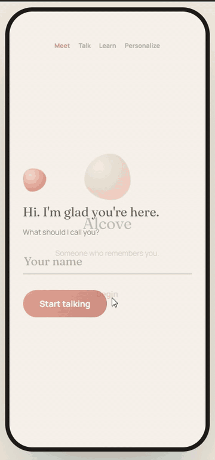
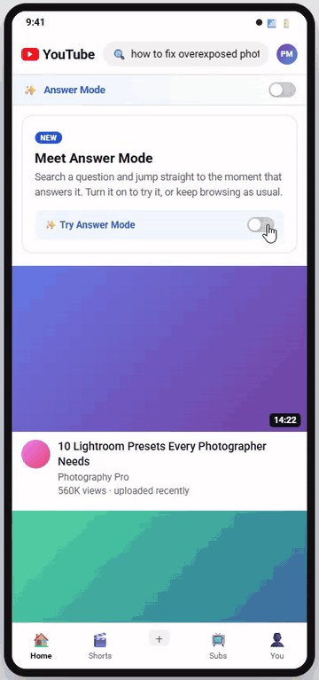
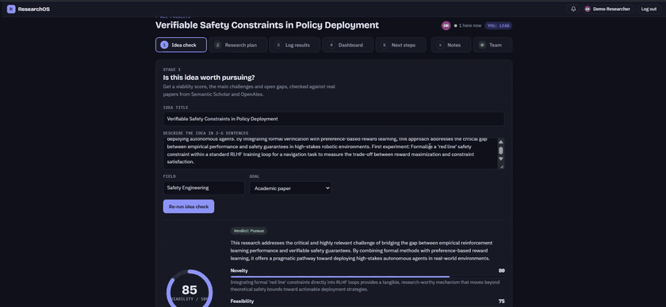
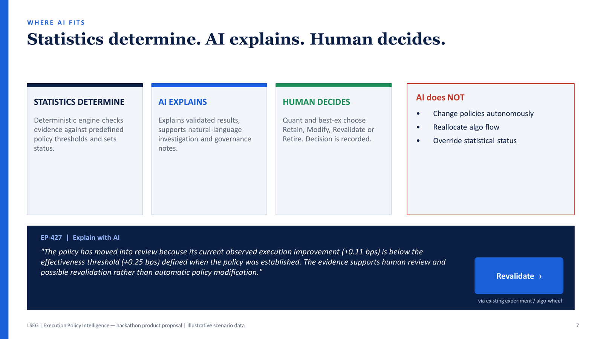
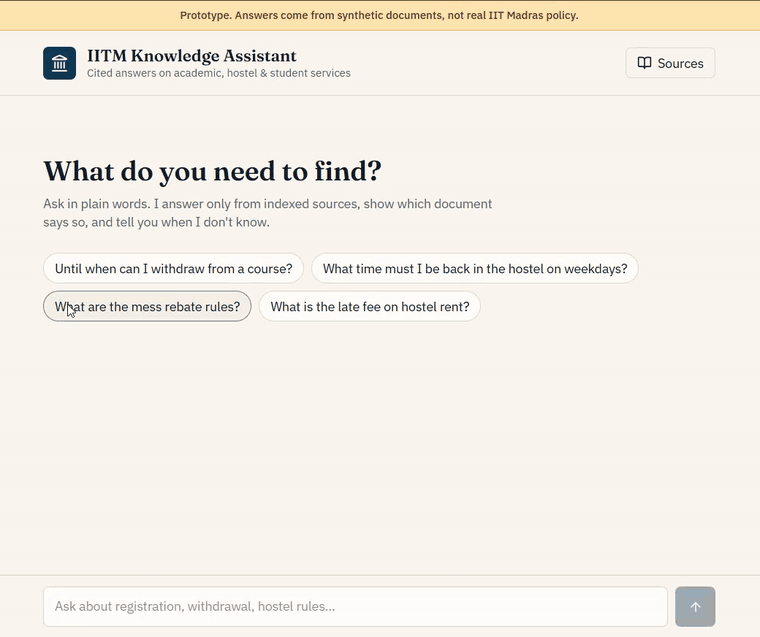

# Saurav — Product Portfolio

**AI Product Manager · CSPO · MBA, Product Management**

12+ years shipping software at London Stock Exchange Group, NatWest (via Publicis Sapient), Clarivate, Thomson Reuters and Ullink, now building AI products. Every project here starts from a real user problem, grounds it in evidence, defines success, designs the AI to be trusted, and ships something you can click.

> **⏱ Short on time? Start here:**
> 1. **[Alcove](#alcove)**: a voice-first AI companion with long-term memory and a safety layer against dependency. [Click through the prototype](https://worldofnisho-471.github.io/Product-Portfolio/Alcove%20AI%20Companion/Alcove-Companion_AI_Full_Prototype.html).
> 2. **[YouTube Answer Mode](#youtube-answer-mode)**: the full PM journey from user research to PRD to prototype. Watch the 40-second GIF, then skim the [case study](YouTube%20Answer%20Mode%20Feature/YouTube_Answer_Mode_Case_Study.pdf).
> 3. **[ResearchOS](#researchos)**: an AI app I built and shipped solo, then tested with researchers. [Try it live](https://research-os-beige-five.vercel.app).
> 4. **[Execution Policy Intelligence](#execution-policy-intelligence)**: an FX product proposal from my current domain, built on "statistics determine, AI explains, human decides".

## Projects

| Project | What it is | Try it | Read it |
|---|---|---|---|
| [**Alcove**](#alcove) | Voice-first AI companion that remembers you | [Prototype](https://worldofnisho-471.github.io/Product-Portfolio/Alcove%20AI%20Companion/Alcove-Companion_AI_Full_Prototype.html) | [PRD](https://super-carnation-374.notion.site/Alcove-Companion-AI-Product-Requirements-Document-3dad6ff9cdd680abbc3bf07e7cd85f6e) |
| [**YouTube Answer Mode**](#youtube-answer-mode) | Search that jumps to the moment that answers your question | [Prototype](https://worldofnisho-471.github.io/Product-Portfolio/YouTube%20Answer%20Mode%20Feature/YouTube-Answer-Mode-Full-Prototype.html) | [PRD](https://super-carnation-374.notion.site/YouTube-Answer-Mode-Product-Requirements-Document-3ccd6ff9cdd680c499bff0fe485de50f) |
| [**ResearchOS**](#researchos) | AI research-management suite, shipped solo | [Live app](https://research-os-beige-five.vercel.app) | [Pitch deck](ResearchOS%20Research%20Management%20Suite/ResearchOS%20Pitch%20Deck.pdf) |
| [**Execution Policy Intelligence**](#execution-policy-intelligence) | Evidence-backed FX execution-policy register | — | [Pitch deck](LSEG%20Hackathon%20Idea/FxAll_Execution_Policy_Intelligence_Leadership_Demo.pdf) |
| [**IITM Knowledge Assistant**](#iitm-knowledge-assistant) | Citation-first RAG assistant for student questions | [Live app](https://rag-whisperer-36.lovable.app/) | [PRD](IIT%20Madras%20RAG%20Knowledge%20Assistant/IIT_Madras_Knowledge_Assistant_PRD.pdf) |

---

## Alcove

*An emotionally intelligent AI companion · HelloPM AI PM course*

  
   Prototype tour (2× speed). Click to try it.

**Problem.** People talk to AI every day, but the relationship resets every session. Assistants forget your goals, your important moments and how you've changed.

**Solution.** A voice-first companion built on long-term memory. The LLM only ever sees a bounded context of the most relevant memories, ranked by relevance, importance and recency. A safety layer guards against dependency, and users can see, correct and delete anything Alcove remembers. The design deliberately leaves out manipulative engagement mechanics.

**Metrics.** North Star: weekly users who feel Alcove understood or remembered them. The product doesn't optimise for session length.

📎 PRD: [Read online](https://super-carnation-374.notion.site/Alcove-Companion-AI-Product-Requirements-Document-3dad6ff9cdd680abbc3bf07e7cd85f6e) · [PDF](Alcove%20AI%20Companion/Alcove_Companion_AI-Product_Requirement_Document.pdf) · [Investor deck](Alcove%20AI%20Companion/Alcove-Companion-AI-Investor-Deck_v2.pdf) · [Prototype](https://worldofnisho-471.github.io/Product-Portfolio/Alcove%20AI%20Companion/Alcove-Companion_AI_Full_Prototype.html)

---

## YouTube Answer Mode

*Search that finds the moment · HelloPM AI PM course*

  
   Prototype tour (1.5× speed). Click to try it.

**Problem.** YouTube Search finds the video, but rarely the moment. In my research (interviews, a 60-person survey and screen-share sessions), **21 of 26** participants opened several videos to find one answer, and **19 of 26** abandoned useful videos because finding the answer took too long.

**Solution.** An opt-in mode that ranks the *moments* that answer a query. It uses confidence tiers instead of false-precision scores, explains why each moment matched, offers a one-tap jump with a full-video fallback, and asks for per-moment feedback that trains ranking.

**Metrics.** North Star: Answer Discovery Success Rate. Guardrail: long-form watch time, so creators aren't hurt.

📎 PRD: [Read online](https://super-carnation-374.notion.site/YouTube-Answer-Mode-Product-Requirements-Document-3ccd6ff9cdd680c499bff0fe485de50f) · [PDF](YouTube%20Answer%20Mode%20Feature/YouTube_Answer_Mode-Product_Requirements_Document.pdf) · [Case study](YouTube%20Answer%20Mode%20Feature/YouTube_Answer_Mode_Case_Study.pdf) · [Prototype](https://worldofnisho-471.github.io/Product-Portfolio/YouTube%20Answer%20Mode%20Feature/YouTube-Answer-Mode-Full-Prototype.html) 
🔍 Process: [1. Problem discovery](https://super-carnation-374.notion.site/1-YouTube-Answer-Mode-Problem-Discovery-3b0d6ff9cdd6806f9fa1dfc0de553c4b) → [2. User research](https://super-carnation-374.notion.site/2-YouTube-Answer-Mode-User-Research-3b8d6ff9cdd68094b37fdae0d5bced33) → [3. Problem framing & solution](https://super-carnation-374.notion.site/3-YouTube-Answer-Mode-Problem-Framing-Solution-3ccd6ff9cdd6804297e8cb8b55deb9f4) ([PDFs](YouTube%20Answer%20Mode%20Feature/))

---

## ResearchOS

*AI research-management suite · Buildathon 2026 · designed, built and shipped solo*

  
   30-second tour of the live app. Click to try it.

**Problem.** Researchers juggle Google Scholar, spreadsheets and supervisor meetings, and nothing connects the idea, the plan and the results.

**Solution.** Idea check → research plan → log results → dashboard → AI-proposed next steps. When a result misses its target, the AI rewrites the plan and explains why.

**Built to be trusted.** Idea checks cite real papers only (Semantic Scholar, OpenAlex). Every score shows its assumptions. A Lead approves every AI change to the plan.

**Validated.** Tested with three IIT Bombay researchers. I turned their feedback into shipped changes and a roadmap: grounding, a data-privacy tier and voice logging.

📎 [Live app](https://research-os-beige-five.vercel.app) · [Pitch deck](ResearchOS%20Research%20Management%20Suite/ResearchOS%20Pitch%20Deck.pdf) · [User feedback & actions](ResearchOS%20Research%20Management%20Suite/User%20Feedback%20For%20ResearchOS%20And%20Actions%20Taken.pdf) · [Design prototype](https://worldofnisho-471.github.io/Product-Portfolio/ResearchOS%20Research%20Management%20Suite/ResearchOS.html)

**Stack:** Vercel · Supabase · Gemini API · Semantic Scholar & OpenAlex APIs

---

## Execution Policy Intelligence

*FX product proposal · LSEG hackathon · October 2026*

  
   The core design principle. Click to open the full 12-slide deck.

**Problem.** FX desks can analyse execution, but they can't easily prove, continuously, that their execution policies still work. The evidence is scattered across TCA outputs, notebooks and committee minutes.

**Proposal.** An Execution Policy Register built on Tradefeedr evidence. It tracks each policy's rationale, evidence, review triggers and decision history. A deterministic engine sets each policy's status, AI explains it, and quants decide. AI never changes a policy on its own.

**Strategy.** The deck covers the competitive landscape (Bloomberg BTCA, FairXchange/360T, in-house tools), strategic fit with FXall and Workspace, a regulatory beachhead, a primary success metric, and a recommendation to validate with customers before scaling.

📎 [Pitch deck](LSEG%20Hackathon%20Idea/FxAll_Execution_Policy_Intelligence_Leadership_Demo.pdf) (scenario data is illustrative)

---

## IITM Knowledge Assistant

*Citation-first RAG for IIT Madras student questions · HelloPM AI PM course*

  
   Prototype tour (1.5× speed): a cited answer, a follow-up, then a refusal to guess when no source exists. Click to try it.

**Problem.** Students know what they need, but not which page, circular or office owns the answer, or whether a newer circular has overridden the rule.

**Solution.** An information-retrieval product first and a chatbot second. It uses hybrid BM25 + vector retrieval and reranks 20 candidates down to 5. A grounding gate decides whether to answer, abstain or flag a conflict, and every answer cites its source. The MVP covers public sources only, with no private records.

**Evals.** Targets include Recall@5 ≥ 90%, unsupported claims < 1%, citation correctness ≥ 95% and 100% pass on prompt-injection tests.

📎 [PRD](IIT%20Madras%20RAG%20Knowledge%20Assistant/IIT_Madras_Knowledge_Assistant_PRD.pdf) · [Live prototype](https://rag-whisperer-36.lovable.app/) (runs on synthetic test documents)

---

## Skills

**Discovery:** interviews, surveys, personas, JTBD · **Definition:** PRDs, MVP scoping, metrics and guardrails, rollouts · **AI design:** RAG, retrieval and reranking, grounding, long-term memory, human-in-the-loop · **Responsible AI:** evals, prompt-injection defence, privacy by design · **Strategy:** competitive analysis, GTM, pricing, business cases · **Building:** Lovable, Vercel, Supabase, Gemini API

## About me

MBA in Product Management (Woolf) · Certified Scrum Product Owner · AI Product Manager course, HelloPM (in progress)

💻 [GitHub](https://github.com/worldofnisho-471) · ✉️ sauravdasgupta377@gmail.com

---

© 2026 Saurav Dasgupta. All rights reserved. This portfolio is shared for viewing only; no part of it may be copied, modified or reused without written permission. Product and company names belong to their respective owners. See [LICENSE](LICENSE).
